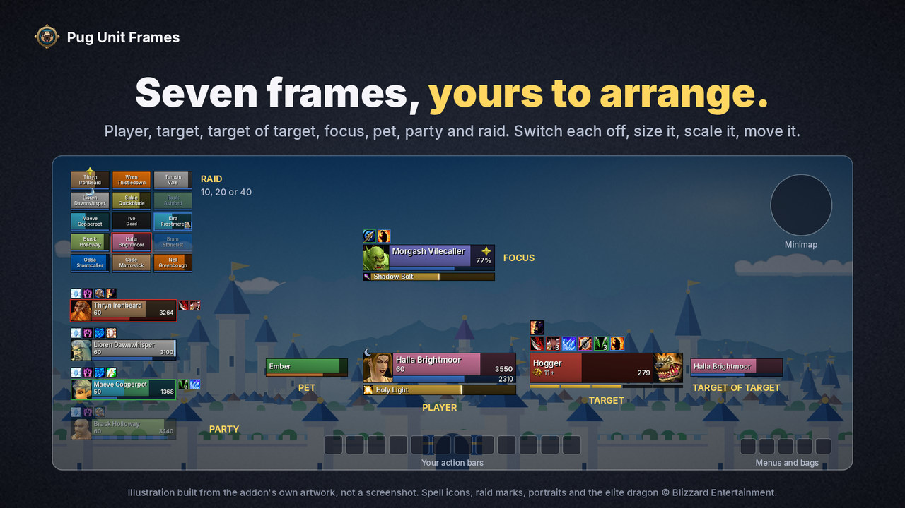
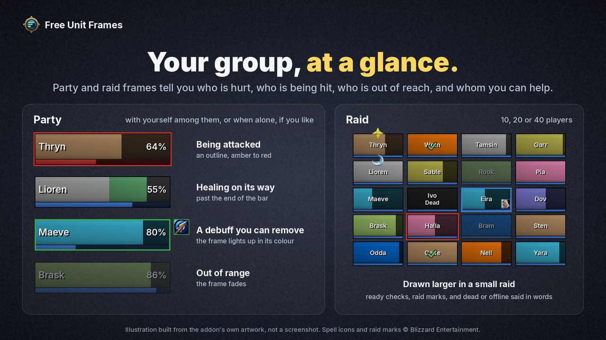
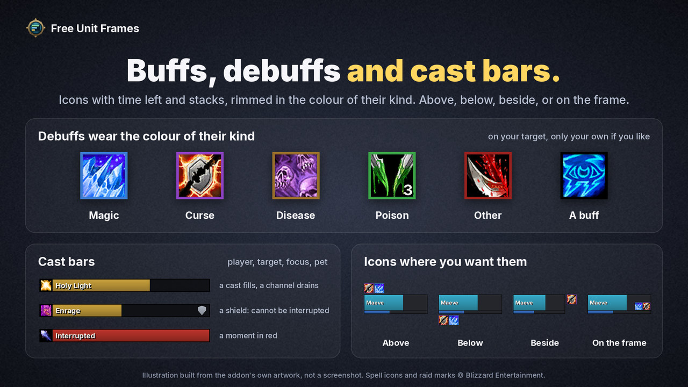

<p align="center">
  
</p>

<h1 align="center">Free Unit Frames</h1>

<p align="center">
  <b>Clean, light unit frames for World of Warcraft: Forever.</b><br>
  You, your target and its target, focus, pet, party and raid: dark, thin and easy to read.
</p>

<p align="center">
  <a href="https://github.com/skytruax/FreeUnitFrames/releases/latest"></a>
  <a href="https://github.com/skytruax/FreeUnitFrames/actions/workflows/tests.yml"></a>
  
  <a href="LICENSE"></a>
</p>

<p align="center">
  <a href="#install">Install</a> ·
  <a href="#what-you-get">What you get</a> ·
  <a href="#settings">Settings</a> ·
  <a href="#how-it-is-built">How it is built</a> ·
  <a href="#developing">Developing</a>
</p>

<p align="center">
  
</p>

<p align="center"><sub>The moving picture is the addon's own code drawing a fight in a simulator of the game's interface, over a
painted city (<a href="#developing">how</a>). The picture at the top is an illustration built from the addon's own artwork.
Neither is a screenshot of the game. The spell icons and raid marks in them are Blizzard's, and the title lettering is
LifeCraft, a typeface by Eliot Truelove.</sub></p>

---

## Status

**0.1 is the first version.** It passes both of its test suites (a model of the client that seals
values the way the game does, and a simulator running Blizzard's real interface code). Neither is
the game, and this version comes straight from them, so expect a rough edge. If something looks
wrong in the game, `/freeuf status` lists any error it caught: please open an issue with that text.

## What you get

<table>
  <tr>
    <td width="50%" valign="top">
      
      <b>Seven frames, yours to arrange.</b> Player, target, target of target, focus, pet, party,
      and raid for 10, 20 or 40. Each can be switched off, sized, scaled and moved on its own.
    </td>
    <td width="50%" valign="top">
      
      <b>Your group, at a glance.</b> An outline on whoever is being attacked, healing on its way
      past the end of the bar, a frame lit in the colour of a debuff you can remove, and members
      out of range faded.
    </td>
  </tr>
  <tr>
    <td width="50%" valign="top">
      
      <b>Built for how Forever fights.</b> In a fight the game seals health, names, casts and auras
      from addons. These frames are written around that, and a late joiner gets a frame at once.
    </td>
    <td width="50%" valign="top">
      
      <b>Buffs, debuffs and cast bars.</b> Icons with time left and stacks, debuffs rimmed in the
      colour of their kind, on the target only your own if you like. Cast bars with a shield on a
      cast that cannot be interrupted and a moment of red when one is.
    </td>
  </tr>
  <tr>
    <td width="50%" valign="top">
      
      <b>Three looks, three textures.</b> Slate, Night and Hearth, all drawn for this addon, lettered
      in Inter (which the addon brings with it; the game's own font is one setting away), with a
      soft shadow under every plate. Health coloured by class, by friend or foe, by how much is
      left, or plain; numbers exact, short, as a percentage, or as what is missing.
    </td>
    <td width="50%" valign="top">
      
      <b>Unlock, drag, done.</b> A handle on every frame, and everything else in the options, frame
      by frame. Profiles can be copied, switched per character, and carried in and out as text.
    </td>
  </tr>
</table>

Also in there: raid icons, the leader's crown, resting, in combat, ready-check answers and a
resurrection on its way; combo points on the target for rogues and druids and totems under the
player for shamans; party frames when you are alone, if you like to see yourself there; English,
German, Spanish and French.

A click on a frame targets the unit, a right click opens its menu, and addons that bind spells to
clicks on unit frames find these frames where they look for them.

<sub>These six pictures are illustrations, not screenshots, drawn by <code>tools/make_listing.py</code>
from the addon's own textures and layout numbers. The spell icons and raid marks in them are Blizzard's.</sub>

## Install

1. Download the zip from the [latest release](https://github.com/skytruax/FreeUnitFrames/releases/latest).
2. Unzip it into `World of Warcraft\_forever_\Interface\AddOns\`, so that you end up with
   `...\AddOns\FreeUnitFrames\FreeUnitFrames.toc`.
3. Start the game, or log out and in again if it is running.

The game's own player, target, focus, pet, party and raid frames and its cast bar step aside for the
ones this addon draws. Each can be kept: Options > AddOns > Free Unit Frames.

## Settings

`/freeuf` opens the options.

| Command | What it does |
| --- | --- |
| `/freeuf` | open the options |
| `/freeuf unlock` | show a green box on every frame; drag one to move its frame |
| `/freeuf lock` | put the boxes away |
| `/freeuf reset <frame\|all>` | put a frame back where and how it started (`player`, `target`, `targettarget`, `focus`, `pet`, `party`, `raid`) |
| `/freeuf profile` | your settings as text to copy; paste someone else's to bring them in as a new profile |
| `/freeuf status` | version, what the game is sealing right now, and any errors caught this session |

Frames are protected by the game while you fight: they can be moved, sized, switched on and off only
out of combat. A change made in a fight is kept and happens when the fight ends.

## How it is built

On this client much of what a unit frame shows reaches an addon **sealed**: the game hands over a
value that can be passed on to be drawn, and that the addon may not read, compare or calculate with.
Health always is. Maximum health, power, names, classes, casts, auras, threat and range are under
conditions Blizzard documents.

Free Unit Frames is written so that it never needs to know. Every such value goes straight from the
game function that answers it to a widget method that Blizzard documents as accepting sealed
values: a bar's value, a text, a texture, an alpha. Where something has to be decided on a number
the addon cannot see (which threat outline? how many combo points?), the deciding is given to the
game too: a row of bars, each running from one level to the next, which the game fills.

All of that lives in one file, [`Sealed.lua`](FreeUnitFrames/Sealed.lua), and the test suite fails
if any other file calls a game function whose answer can be sealed. The list of those functions is
made from Blizzard's own API documentation.

The frames are the game's secure unit buttons, and party and raid are its secure group headers, so
they keep working in combat, including for someone who joins in the middle of a fight. No library
and no other addon's code is included, the game's menus are left alone, and none of its code is
hooked. The game's own frames are put away as the addon loads, before any of them has come up, so
that none of their code runs on the addon's account: on this client that is what keeps protected
actions, a controller's among them, from being refused later.

## Developing

```
FreeUnitFrames/        the addon: what goes into Interface/AddOns
  Sealed.lua           the one place that touches values the game can seal
  Frame.lua            the plate, the events, and the layout every frame shares
  Elements/            one file per thing a frame shows
  Units.lua Group.lua  the single frames; the party and raid headers
tools/
  tests/               the model of the client and the scenarios run against it
  sim/                 the simulator run: Blizzard's real interface code, in Docker
    run.sh demo.sh     the tests and the picture; the moving demo
    photos.sh          the picture over photographs of your own, each marked as a composite
    scene_art.py       what a picture needs that the simulator lacks: icons, raid marks, a world, the font
  make_art.py          draws every texture the addon ships
  make_listing.py      draws the banner, the logo and the store pictures
  game_icons.py        fetches the game's own spell icons and raid marks those pictures show
  brand.py             the look those pictures share with FreeControl's
  sealed_list.py       makes tools/sealed_apis.txt from Blizzard's API documentation
```

Two test suites, neither needing the game:

```
pip install lupa==2.8
python3 tools/tests/run.py           # a model of the client that seals values; also checks the source
tools/sim/lab/build-image.sh         # once: fetches the simulator and builds its Docker image
tools/sim/run.sh                     # Blizzard's interface code with the addon loaded; takes a picture
tools/sim/demo.sh                    # the same fight, moment by moment: docs/demo.gif
tools/sim/photos.sh                  # the same fight over pictures of your own (tools/sim/backdrops/)
```

Neither is the game. The model is written from Blizzard's documentation and the simulator does not
seal values, so anything that depends on how the live client behaves is confirmed by playing.

<p align="center">
  
</p>

<p align="center"><sub>The addon's own code drawing beside Blizzard's interface code in the simulator. The simulator has
none of the game's art and no world, and reads no font from an addon's folder, so the scene
(<code>tools/sim/tests/sim/screenshot.lua</code>) hands it the game's icons for its spells, the raid marks, a painted city
and the addon's own font, and answers the game functions the simulator has no handle for: other units' auras, casts
and power, threat, range. Blizzard's own interface, bare without its art, is put away.</sub></p>

The pictures and textures are drawn by scripts too (`pip install pillow numpy`):

```
python3 tools/make_art.py            # the textures in FreeUnitFrames/Art
python3 tools/make_listing.py        # docs/banner.png, docs/social.png, the logo, curseforge/gallery
```

The pictures show the game's own spell icons and raid marks, as the frames do in the game. Those
are Blizzard Entertainment's and are not part of this repository: `tools/game_icons.py` fetches
them into a git-ignored folder from a [public mirror](https://github.com/Gethe/wow-ui-textures) of
the game's interface art when the pictures are built (`--placeholders` draws stand-ins instead).
The addon itself ships no icon: it hands whatever the game names back to the game to draw.

## Licence

MIT. See [LICENSE](LICENSE).

The addon brings one thing that is not ours: the typeface its frames are lettered in,
[Inter](https://github.com/rsms/inter) by the Inter Project Authors, under the SIL Open Font
License 1.1. The font file is unchanged and its licence is beside it
([FreeUnitFrames/Fonts](FreeUnitFrames/Fonts)).

The simulator the tests use is a separate project under GPL-3.0
([wow-ui-sim](https://github.com/Osso/wow-ui-sim)); nothing of it is part of the addon.
