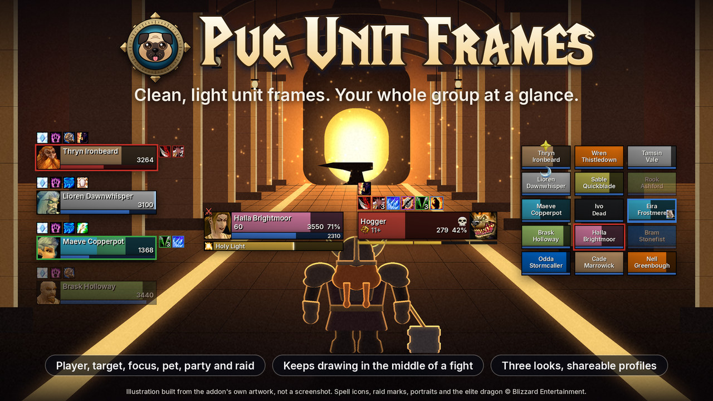
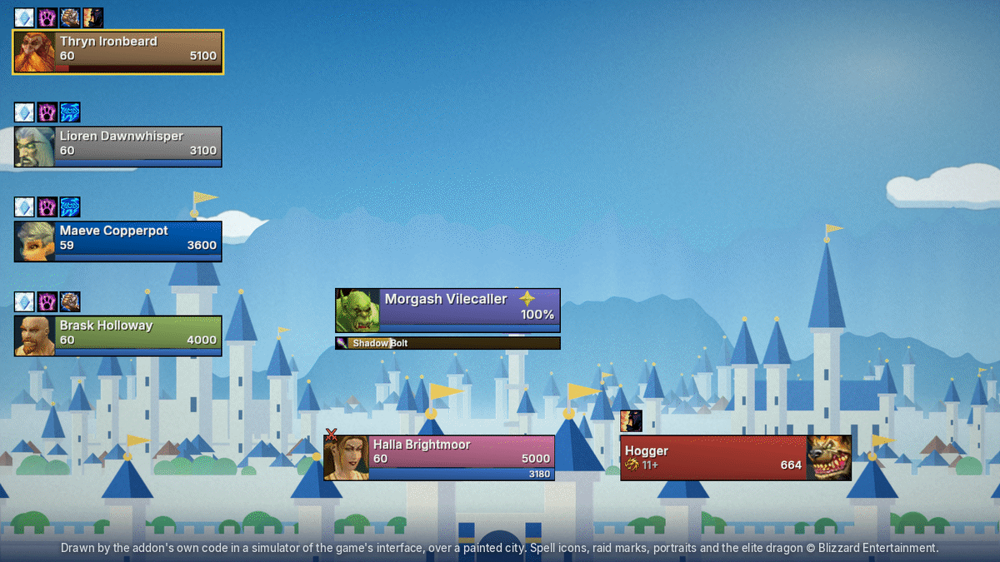
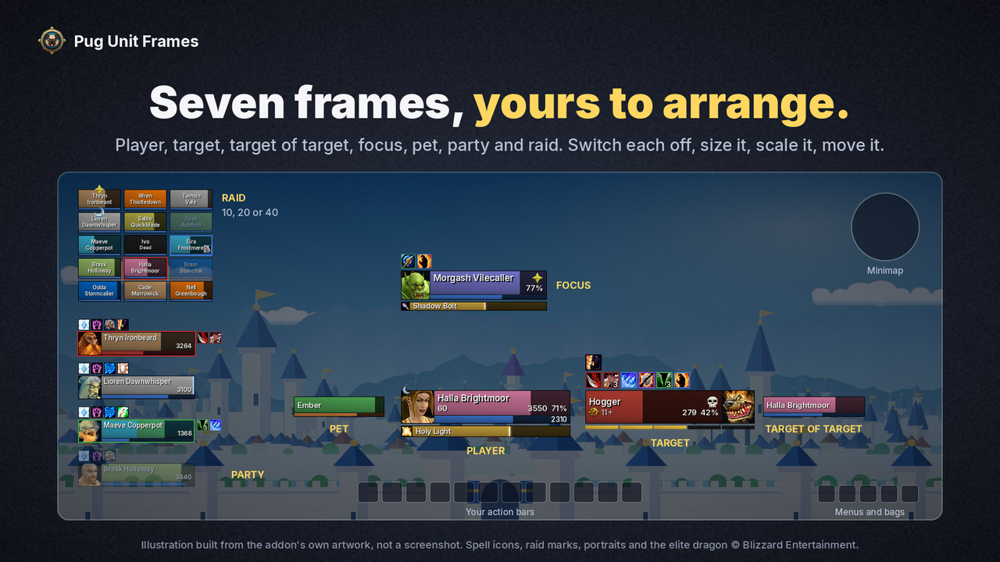
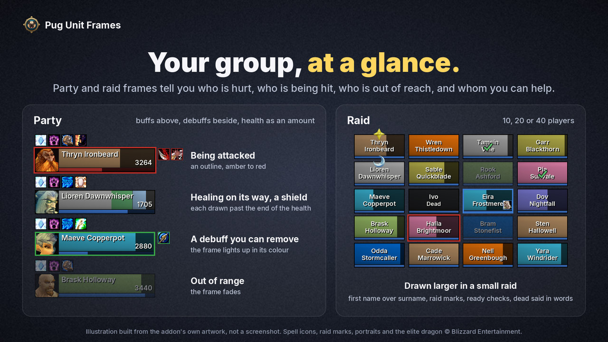
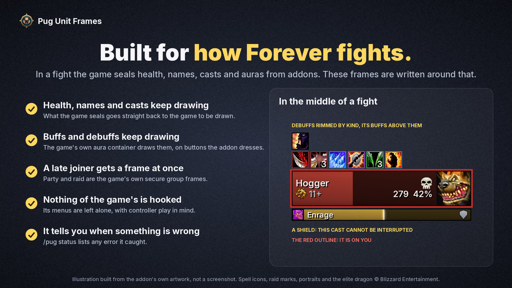
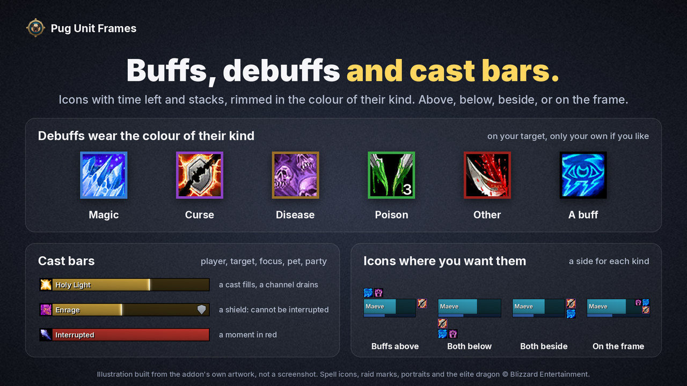
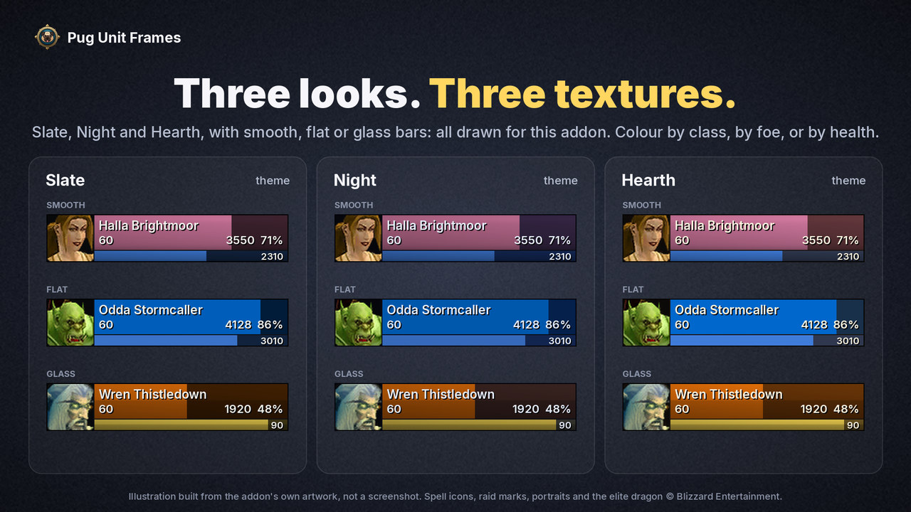
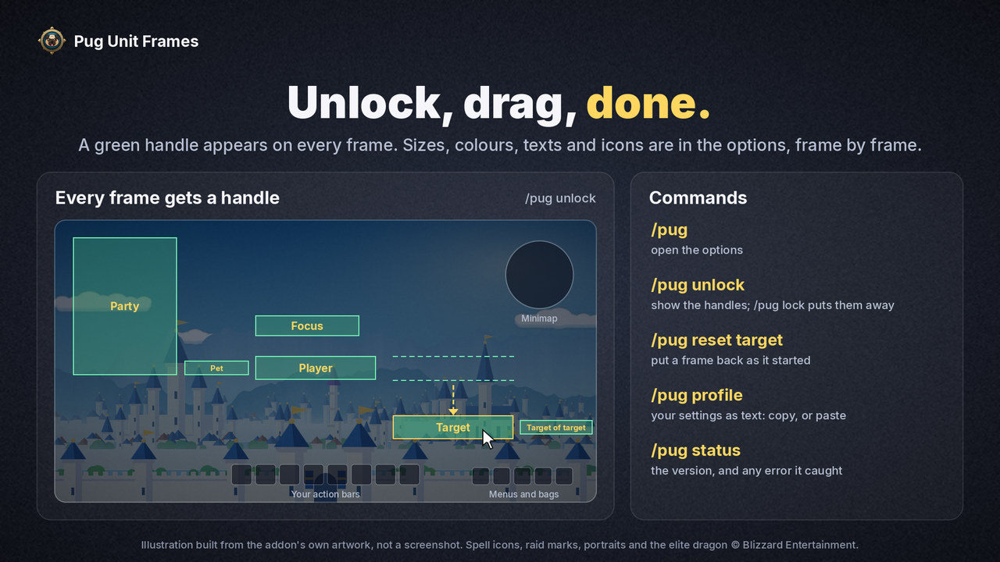

## Unit frames in the PitBull tradition, for Forever. Light, and ready the moment you log in.

**If you miss PitBull on Forever, start here.** Pug Unit Frames gives you the clean, class-coloured frames PitBull players build for themselves (player, target, focus, pet, party and raid) without an evening in the options, and it is written from scratch for the way Forever fights.

**A homage, not the original.** [PitBull Unit Frames 4.0](https://www.curseforge.com/wow/addons/pitbull-unit-frames-4-0), by ckknight, shefkin and nebula169, is the dog-themed unit frames addon a great many of us played with for years, and the credit for the idea belongs to them. PitBull has not come to Forever, so here is a smaller dog in its honour. Pug Unit Frames is not that project and has nothing to do with its authors: it is a new addon, written from scratch, with none of PitBull's code or art in it. The name is a pug's, and a PUG's: the pick-up group these frames are for.

Everything a frame should tell you is there, and nothing shouts. Bars are coloured by class or by friend and foe, numbers are written the way you like them, and the things that matter in a fight (who is being hit, who is out of reach, whom you can help) show up on the frame itself. It is one small folder with no libraries in it.

## Why you will like it

### Seven frames, yours to arrange

Player, target, target of target, focus, pet, party and raid. Switch each one off, size it, scale it, and put it where you want it. The player, target, focus and pet have their own cast bars; the target shows its buffs and debuffs, and your combo points if you are a rogue or a druid. Shamans get their totems under the player frame and send one away with a right click, a druid in a form keeps a strip of mana under the form's bar, and a hunter sees how the pet feels beside its frame.

You, your target, your focus and each party member have a portrait. A character's first name and surname are both written, on a line of their own wherever a frame has the height, which is also where a long creature name fits without being cut short; a raid frame writes the first name over the surname. An elite or rare creature has the game's own dragon beside its level, and a creature that one of your quests needs carries Questie's icon in the corner of the frame, if you run Questie.

### Your group, at a glance

Party and raid frames tell you what you need without a second look: an outline on whoever is being attacked, healing on its way drawn past the end of the health bar, a frame lit in the colour of a debuff you can remove, and members out of range faded. A shield that soaks up damage is drawn the same way, in a pale colour after the health, with a pale cap on the end of the bar when there is more shield than room (as on someone at full health), and whoever you have targeted is outlined. Raid frames come for 10, 20 or 40 players and are drawn larger in a small raid. Each party member's buffs stand in a row above the frame, as your target's do, with the debuffs beside it, and health is written as an amount. Ready checks, raid icons and a resurrection on its way show on the frame; the leader's crown, a mark for tank, healer and damage and a PvP flag are there if you switch them on; and the party can stand in order of role.

### Built for how Forever fights

In a fight, Forever seals much of what a unit frame shows: an addon is handed health, names and casts that it can pass on to be drawn and may not read, and buffs and debuffs it may not even ask about. Pug Unit Frames is written around that: sealed values go straight to the game's own drawing, buffs and debuffs are drawn by the game's own aura container on buttons the addon dresses, and someone who joins your group mid-pull gets a working frame at once. It includes no library and no other addon's code.

### Buffs, debuffs and cast bars

Icons show their time left, as a sweep or as a number, and their stacks. Debuffs are rimmed in the colour of their kind (magic, curse, disease, poison), and you can show only your own, buffs or debuffs. Buffs and debuffs each go where you want them: above, below or beside a frame, or on the frame itself. A cast bar fills for a cast and drains for a channel with a bright edge on the end of its fill, shows a shield when the cast cannot be interrupted, and flashes red when it is.

### Three looks, three textures

Slate, Night and Hearth, each with smooth, flat or glass bars, all drawn for this addon. The frames are lettered in Inter, a clean typeface the addon brings with it (the game's own font is one setting away), and every plate casts a soft shadow, so the frames stand off whatever is behind them. The empty part of a bar keeps the bar's colour, darkened, so you still read a class at a glance when someone is nearly dead.

Colour health by class, by friend or foe, by how much is left, or keep it plain. Let the bars fill to the right, to the left or upwards, or turn a bar round so that it is dark and the colour shows where health is missing. Write health and power as exact numbers, short numbers, a percentage, or as what is missing.

### Unlock, drag, done

Type **/pug unlock** and a green handle appears on every frame: drag one to move its frame, then **/pug lock**. Everything else is in the options, frame by frame. Profiles can be copied, switched per character, and shared as text.

## Getting started

Type **/pug** for the options.

- **/pug unlock** shows the handles; **/pug lock** puts them away.
- **/pug reset player** (or target, targettarget, focus, pet, party, raid, all) puts a frame back where and how it started.
- **/pug profile** gives you your settings as text, and takes someone else's.
- **/pug status** tells you the version and lists any error the addon caught. That is what to send when something looks wrong.

Click a frame to target, with Shift, Ctrl or Alt held as well, and right-click for the menu. The game's ping key pings whoever a frame shows. Click-casting addons find these frames where they look for them.

## Good to know

- The game's own unit frames and cast bar step aside for these. Each can be kept: Options > AddOns > Pug Unit Frames.
- The game protects unit frames while you fight. They can be moved and sized out of combat; a change you make in a fight happens when it ends.
- Made with controller play in mind: it hooks none of the game's code and leaves its menus alone, and the game's own target frame, which the controller's menu on your target belongs to, is set aside unseen and not hidden, so that menu still opens.
- Questie's quest icon needs Questie. In a dungeon the game does not tell addons which creature a unit is, so there is no icon there.
- The player's frame can fade while nothing is going on, or stay away while you are in a group, and the game's own frames can stay hidden also where the frame here is switched off.
- English, German, Spanish and French. Where the game runs in Korean or Chinese, the frames are lettered in the game's own font.
- It is a homage to PitBull, not a copy of it: there are no text tags to script and no modules to switch on. It has the settings most players reach for, frame by frame, and more are on the way.
- It was called Free Unit Frames until version 0.2. If you had that installed, delete the old FreeUnitFrames folder; the command is now **/pug**.
- These are early versions. Reports are welcome, with the text of **/pug status**.

Source, issues and tests: [github.com/skytruax/PugUnitFrames](https://github.com/skytruax/PugUnitFrames)

The moving picture was drawn by the addon's own code in a simulator of the game's interface, over a painted city. The other pictures are illustrations built from the addon's own artwork. None is a screenshot of the game. The spell icons, raid marks, portraits and the dragon beside an elite's level in them are Blizzard's. The pug of the emblem and the dwarf in his forge hall are our own drawings. The title lettering is LifeCraft, a typeface by Eliot Truelove, and the lettering on the frames is Inter, by the Inter Project Authors (SIL Open Font License).
